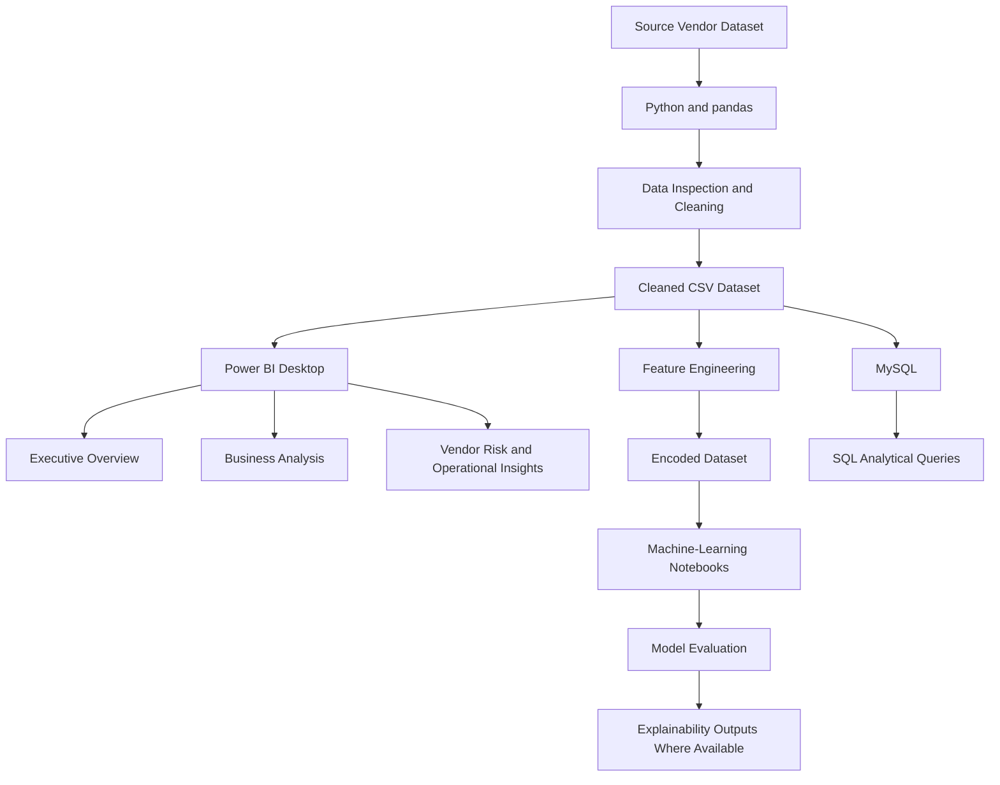

# Street Vendor Survival Prediction Using Machine Learning

Project for municipal corporation to analyze factors linked to the one-year survival outcome of street food vendors using data preparation, exploratory data analysis (EDA), feature engineering, SQL, machine learning experiments, model explainability, and Power BI Desktop visualizations.

> **Implementation status:** The feature-engineered datasets and Power BI dashboard development work have been done. However, the streamlit app development and AI integration are pending and fall under future work. The repository here is not for a deployed prediction model.
## Table of Contents

- [Problem Statement](#problem-statement)
- [Objectives](#objectives)
- [Dataset](#dataset)
- [Technology Stack](#technology-stack)
- [Workflow and Architecture](#workflow-and-architecture)
- [Repository Structure](#repository-structure)
- [Data Dictionary Overview](#data-dictionary-overview)
- [Setup and Installation](#setup-and-installation)
- [Running the Completed Components](#running-the-completed-components)
- [Results and Key Findings](#results-and-key-findings)
- [Power BI Dashboards](#power-bi-dashboards)
- [Testing and Validation](#testing-and-validation)
- [Limitations](#limitations)
- [Future Work](#future-work)
- [Contributor and Acknowledgements](#contributor-and-acknowledgements)
- [License](#license)

## Problem Statement

Street vendor business results could depend on various aspects related to their operations, finances, locations, regulations, as well as customers. In this project, these aspects will be structured into an analytic process allowing patterns, differences, and associations to be identified and classification experiments to be done with a binary survival result for 12 months.

This project is a prototype for educational analytics. The dataset seems to be artificial and should not be considered as factual information from the real world. Predictions cannot be used to make decisions concerning any individual vendor without further validation.
## Objectives

The key goals of the project include the following:

- Inspecting, cleaning, and preparing the vendor dataset for analysis.
- Conducting exploratory data analysis of survival performance and associations between vendor attributes and operational characteristics.
- Developing interpretable ratios and categorical variables suitable for machine learning.
- Using SQL for answering analytical questions regarding vendors, location, operations, and compliance.
- Trying out different classification algorithms and evaluating metrics within notebooks.
- Looking into feature importance and SHAP explainability artifacts wherever available.
- Creating business dashboards interactively with the use of Power BI Desktop.
- Identifying the shortcomings of the dataset and separating completed modules from upcoming improvements.

## Dataset
The project uses the **Urban Street Food Vendor Survival Dataset (India)**, described in the project materials as a Kaggle dataset.
https://www.kaggle.com/datasets/sinanshereef/urban-street-food-vendor-survival-dataset-india?resource=download

### Dataset summary

| Item | Value |
|---|---:|
| Cleaned dataset | 22,000 rows × 20 columns |
| Feature-engineered dataset | 22,000 rows × 64 columns |
| Survived (`vendor_survived = 1`) | 9,364 (42.56%) |
| Closed (`vendor_survived = 0`) | 12,636 (57.44%) |
| Total records | 22,000 |

**Target interpretation:** `vendor_survived = 1` represents survival, while `vendor_survived = 0` represents closure. The label refers to the dataset's 12-month outcome; it does not establish the vendor's current real-world status.

The original dataset URL and version should be added here before publication.

### Main columns

The cleaned dataset contains the following fields:

- `vendor_id`
- `city`
- `zone_type`
- `vendor_age_years`
- `years_in_business`
- `food_category`
- `license_status`
- `avg_daily_revenue_inr`
- `avg_daily_customers`
- `monthly_stall_rent_inr`
- `num_helpers`
- `hours_open_per_day`
- `competition_within_100m`
- `monthly_health_inspection_score`
- `had_fine_last_year`
- `avg_monthly_rainfall_mm`
- `season_of_observation`
- `has_online_presence`
- `customer_complaint_rate`
- `vendor_survived`

### Feature engineering

The feature-engineered dataset includes derived features such as:

- `estimated_monthly_revenue`
- `revenue_per_customer`
- `rent_to_revenue_ratio`
- `revenue_per_hour`
- `customers_per_hour`
- `operational_load`
- Vendor-age and business-experience categories
- Revenue, competition, inspection, and complaint categories
- One-hot-encoded categorical variables

**Which dataset should you use?**

- **Cleaned CSV:** Recommended for Power BI because original category labels remain readable.
- **Feature-engineered CSV:** Intended for machine-learning workflows and encoded model features.

**Data-quality note:** Project notes indicate that missing inspection scores may have been replaced with zero during feature preparation. If this transformation is present in the final data, zero should not automatically be interpreted as a genuinely poor inspection score; it may represent missing inspection information.

## Technology Stack

| Technology | Purpose |
|---|---|
| Python | Data preparation, EDA, feature engineering, and machine-learning notebooks |
| pandas and NumPy | Data manipulation and numerical calculations |
| Matplotlib and Seaborn | Exploratory plots where used in notebooks |
| scikit-learn | Machine-learning preprocessing and evaluation |
| XGBoost | Candidate model in the documented ML workflow; verify its use in the notebooks |
| SHAP | Model explainability workflow where saved outputs are available |
| MySQL | Structured data storage and SQL analysis |
| Power BI Desktop | Interactive business dashboards |
| Jupyter Notebook and VS Code | Notebook execution and development |

Streamlit and AI integration are not listed as completed components because their implementation remains pending.

## Workflow and Architecture

The process involves the data analysis approach which distinguishes between data preparation, dashboards reporting, SQL analysis, and machine learning experiments.



The diagram represents the logical workflow. Exact script names, execution order, and database schema should be confirmed against the current repository files.

## Repository Structure

The current project directory contains the following top-level folders:

```text
Street-Vendor-Survival-Prediction/
├── datasets/      # Source, cleaned, and feature-engineered datasets
├── figures/       # EDA, model, or report figures, where saved
├── models/        # Trained model artefacts, where saved
├── notebooks/     # Data preparation, EDA, feature engineering, and ML
├── powerbi/       # Power BI Desktop report and related assets
├── reports/       # Project documentation and generated outputs
└── sql/           # Database scripts and analytical queries
```

The exact filenames may vary by local version. Check the contents of each folder before running a component. Keep the original dataset unchanged and document the correct notebook execution order if it is not already recorded.

## Data Dictionary Overview

| Field group | Examples | Meaning |
|---|---|---|
| Identity | `vendor_id` | Record identifier |
| Location and business type | `city`, `zone_type`, `food_category` | Recorded location and business category |
| Vendor profile | `vendor_age_years`, `years_in_business` | Vendor age and business experience |
| Operations | Revenue, customers, rent, helpers, operating hours | Operational and financial indicators |
| Competition and compliance | Competition count, inspection score, fine history, licence status | Competition and compliance-related indicators |
| Environment and digital presence | Rainfall, season, online presence | Environmental and digital-context variables |
| Customer signal | `customer_complaint_rate` | Recorded complaint measure |
| Target | `vendor_survived` | 12-month outcome: `1` survived, `0` closed |

## Setup and Installation

### 1. Clone the repository

Replace the placeholder URL with the actual GitHub repository URL.

```bash
git clone <YOUR_GITHUB_REPOSITORY_URL>
cd Street-Vendor-Survival-Prediction
```

### 2. Create a Python environment

```bash
python -m venv .venv
```

Activate the environment using the appropriate command.

**Windows PowerShell**

```powershell
.venv\Scripts\Activate.ps1
```

**Windows Command Prompt**

```bat
.venv\Scripts\activate.bat
```

**macOS or Linux**

```bash
source .venv/bin/activate
```

### 3. Install dependencies

If the repository contains a verified `requirements.txt`, install the listed dependencies:

```bash
pip install -r requirements.txt
```

If no dependency file is available, install the packages required by the notebooks. A starting point for the documented Python workflow is:

```bash
pip install pandas numpy matplotlib seaborn scikit-learn jupyter
```

Install additional packages only if the corresponding notebooks use them:

```bash
pip install xgboost shap
```

The commands above are a starting point, not a verified dependency lock. Package versions should be tested in the target environment and recorded in a `requirements.txt` before publication.

### 4. Dataset paths

Check the files inside `datasets/` and update notebook paths to match the repository. Avoid relying on machine-specific absolute paths.

Known dataset outputs:

- `street_vendor_survival_cleaned.csv` — 22,000 rows × 20 columns
- `street_vendor_survival_feature_engineered.csv` — 22,000 rows × 64 columns

Use the actual filenames present in the repository if they differ.

## Running the Completed Components

### A. Data preparation and exploratory analysis

1. Open the repository in VS Code or Jupyter Notebook.
2. Review `datasets/` and identify the source and processed CSV files.
3. Open the relevant notebook in `notebooks/`.
4. Update file paths to match your local directory.
5. Run the notebook cells in order.
6. Inspect the exported cleaned dataset and generated figures.
7. Confirm that the target mapping remains `0 = closed` and `1 = survived`.

Review the resulting row counts, missing-value handling, category transformations, and output paths before using the files in subsequent modules.

### B. MySQL analysis

1. Start MySQL Server and open MySQL Workbench or a compatible client.
2. Review the scripts inside `sql/`.
3. Execute the database and table creation scripts, followed by the import steps, in the order supported by the scripts.
4. Run the analytical queries.
5. Verify the filters, grouping, aggregations, and target coding.

The project history refers to the database name `street_vendor_survival`. Confirm the actual SQL DDL before using that database or any table name; do not assume the current schema matches an earlier version.

### C. Machine-learning notebooks

1. Open the relevant notebook in `notebooks/`.
2. Confirm that `vendor_survived` is the target column.
3. Separate predictors from the target before training.
4. Use a reproducible train/test split and check for target leakage.
5. Execute preprocessing, model-fitting, and evaluation cells.
6. Save actual evaluation metrics, confusion matrices, and model artefacts to the appropriate output folders.

Candidate models discussed in project materials include Logistic Regression, Decision Tree, Random Forest, and XGBoost. The final selected model and its evaluation scores should be taken from the saved notebook outputs. No unverified performance values are reported here.

### D. Power BI Desktop dashboards

1. Open the `.pbix` report inside `powerbi/`.
2. If prompted, update the source path to the local cleaned CSV.
3. Refresh the data and verify that the measures and slicers work correctly.
4. Review the three dashboard pages:
   - **Executive Overview / 12-Month Outcomes**
   - **Business Analysis**
   - **Vendor Risk & Operational Insights**
5. Check that survival rates are formatted as percentages and that each visual uses the intended aggregation, such as count, average, or sum.
6. Save the report after confirming the data source and formatting.

Power BI Desktop is the dashboard environment documented for this project. A published Power BI Service workspace or online dashboard is not claimed.

## Results and Key Findings

The following descriptive figures are recorded from the supplied cleaned dataset and project analysis.

| Measure | Result |
|---|---:|
| Total vendor records | 22,000 |
| Survived | 9,364 (42.56%) |
| Closed | 12,636 (57.44%) |
| Average years in business | 10.41 |
| Average operating hours per day | 9.53 |
| Average helpers per vendor | 0.73 |
| Revenue–daily customers correlation | Approximately 0.70 |

These figures describe the supplied dataset. They do not prove that any individual feature causes a vendor to survive or close.

Final model-performance metrics are not included because the corresponding evaluation table could not be verified when this README was prepared. Add accuracy, precision, recall, F1-score, confusion-matrix results, and the selected model only after confirming them from actual notebook outputs.

## Power BI Dashboards

The Power BI report is organised into three pages.

### 1. Executive Overview / 12-Month Outcomes

Presents the overall dataset and survival outcomes, including total vendors, survived vendors, closed vendors, survival rate, vendor counts by city, and average daily revenue by city.

### 2. Business Analysis

Supports comparison of survival rates across locations, licence statuses, and food categories, along with analysis of operational and revenue-related measures.

### 3. Vendor Risk & Operational Insights

Examines operational and compliance-related patterns using fields such as competition, zone type, online presence, and helper counts.

### Dashboard screenshots

Add final screenshots to `reports/screenshots/` and update these paths to match the files committed to GitHub.

```text
reports/
└── screenshots/
    ├── page1-executive-overview.png
    ├── page2-business-analysis.png
    └── page3-vendor-risk.png
```

Embed them in this section:


These images should be added to the repository before publication. Screenshots demonstrate the dashboard layout but do not replace testing the underlying measures, relationships, filters, and slicer interactions.

## Testing and Validation

### Data checks recorded for the supplied files

- The cleaned dataset contains 22,000 rows and 20 columns.
- The cleaned target distribution is 12,636 closed records and 9,364 survived records.
- The feature-engineered dataset contains 22,000 rows and 64 columns.
- The target field is present in the feature-engineered dataset.

### Checks to complete before release

- Execute notebooks from a fresh kernel.
- Verify SQL imports, table definitions, and analytical queries.
- Re-run model evaluation and generate the confusion matrix.
- Verify Power BI refresh, measure aggregation, and slicer interactions.
- Confirm dependency installation and file paths in a clean environment.

Do not mark a pending check as passed until it has actually been run and its result recorded.

## Limitations

- The dataset appears simulated or synthetic, so generalisation to real-world street vendors has not been established.
- Missing-value handling and category encoding require careful interpretation, particularly inspection-score values that may have been replaced with zero.
- Correlation, feature importance, and SHAP explanations do not establish causation.
- The final selected model and its evaluation metrics must be verified from the saved notebook outputs.
- The repository does not contain a completed Streamlit prediction application or AI integration.
- Reproducibility depends on confirming the dependency versions, data paths, SQL schema, and notebook execution order.

## Future Work

Planned enhancements include:

- Complete a Streamlit prediction interface after validating and selecting a final model.
- Add AI integration only after defining its purpose and testing reliability and privacy implications.
- Validate model performance using suitable real-world data where lawfully available.
- Improve the handling and documentation of missing inspection information.
- Add a tested `requirements.txt` and reproducible environment setup.
- Introduce automated data-quality checks and more systematic testing.
- Publish verified model metrics, explainability figures, SQL outputs, and final dashboard screenshots.

These items are future work and should not be interpreted as completed functionality.

## Contributor and Acknowledgements

**Contributor:** Bharat Jain Sanghvi  
**Programme:** B.Tech in Computer Science and Business Systems  
**Institution:** Institute of Engineering & Technology, Devi Ahilya Vishwavidyalaya, Indore, Madhya Pradesh, India

Acknowledgements are due to the dataset provider and the developers and maintainers of Python, pandas, NumPy, scikit-learn, MySQL, Power BI, and other tools used in the project.

## License

Add the licence that applies to this repository and confirm that redistribution of the dataset and related assets is permitted. If the repository already contains a `LICENSE` file, refer to that licence here and ensure that it is compatible with the dataset's terms.

